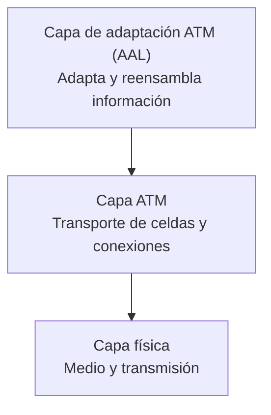

# 🔄 ATM: modo de transferencia asíncrona

> **Objetivo:** conocer qué es ATM, cómo se organiza su arquitectura y por qué fue importante en la evolución de las telecomunicaciones.

## 1. ¿Qué es ATM?

**ATM (Asynchronous Transfer Mode)** es una tecnología de conmutación y transporte diseñada para transportar distintos tipos de información, entre ellos:

* Voz.
* Datos.
* Vídeo.

Fue desarrollada en el contexto de las redes de telecomunicaciones de banda ancha y utiliza una arquitectura diferente de los modelos OSI y TCP/IP.

## 2. Arquitectura de ATM

El modelo ATM se representa habitualmente mediante **tres niveles principales**:

1. **Capa física**
2. **Capa ATM**
3. **Capa de adaptación ATM (AAL)**

## 3. Capa física

Está relacionada con el medio de transmisión y con la transmisión de señales.

Se ocupa de aspectos como:

* El soporte físico utilizado.
* La transmisión de la información.
* La adaptación a las características del medio.

## 4. Capa ATM

Es responsable del transporte de las **celdas ATM** a través de la red.

Entre sus funciones se encuentran:

* Transportar celdas.
* Gestionar conexiones.
* Participar en el encaminamiento o conmutación dentro de la red ATM.
* Gestionar aspectos relacionados con el tráfico y la congestión.

Una característica conocida de ATM es el uso de **celdas de tamaño fijo**, lo que simplifica el procesamiento y fue especialmente relevante para transportar tráfico con diferentes necesidades de calidad de servicio.

## 5. Capa de adaptación ATM (AAL)

La **ATM Adaptation Layer** adapta la información procedente de las aplicaciones al formato utilizado por ATM y realiza el proceso inverso en el receptor.

De forma simplificada:

1. Recibe información de capas superiores.
2. La adapta para su transporte mediante ATM.
3. En destino permite reconstruir la información original.

## 6. ATM frente a OSI y TCP/IP

ATM no debe entenderse como una copia directa de OSI o TCP/IP.

| Modelo / arquitectura | Organización principal    |
| --------------------- | ------------------------- |
| OSI                   | 7 capas                   |
| TCP/IP                | 4 capas clásicas          |
| ATM                   | Física + ATM + Adaptación |

Las capas de ATM **no coinciden exactamente** con las capas del modelo OSI.

## 7. Importancia histórica y situación actual

ATM tuvo una gran importancia en la evolución de las telecomunicaciones y las redes de banda ancha, especialmente por su capacidad para tratar distintos tipos de tráfico.

Actualmente, en la mayoría de redes modernas de empresa y de Internet predominan tecnologías basadas en:

* Ethernet.
* IP.
* MPLS en determinados entornos de operador.

Por eso, ATM es especialmente importante como conocimiento histórico, académico y para comprender la evolución de las arquitecturas de red.

## 8. Lo importante para estudiar

* **ATM** significa _Asynchronous Transfer Mode_.
* Se diseñó para transportar diferentes tipos de tráfico.
* Su arquitectura incluye **capa física, capa ATM y capa de adaptación ATM**.
* Utiliza el concepto de **celdas** para transportar información.
* Su modelo es diferente de OSI y TCP/IP.
* Hoy es menos habitual en redes modernas, pero sigue siendo relevante para comprender la evolución de las telecomunicaciones.

> **Visión profesional:** aunque probablemente no configures ATM en una red empresarial moderna, entender tecnologías anteriores ayuda a interpretar documentación, infraestructuras heredadas y la evolución de los sistemas de comunicación.
