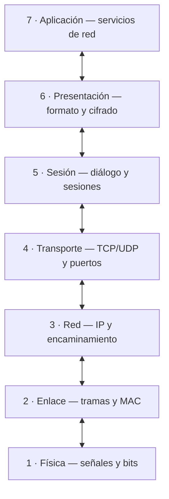
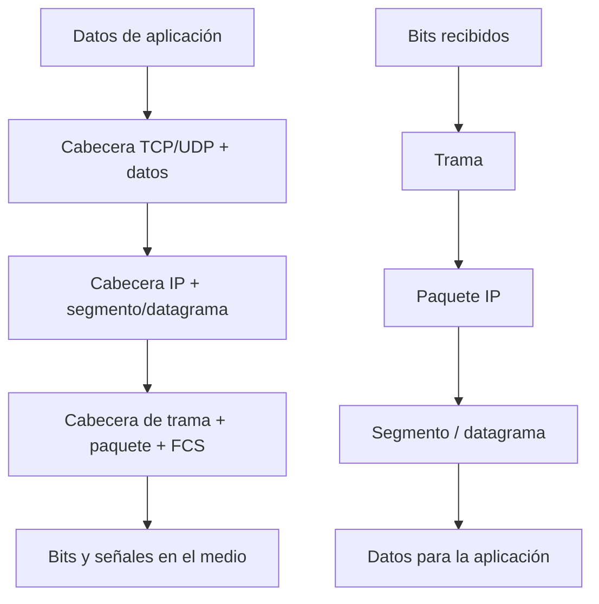

# 💻 Capas del modelo OSI

> **Objetivo de estudio:** comprender cómo se comunican dos dispositivos a través de una red, qué función cumple cada una de las siete capas, qué protocolos y equipos intervienen y cómo se encapsulan los datos.

## 1. ¿Qué es el modelo OSI?

El **modelo OSI (Open Systems Interconnection)** es un modelo de referencia creado por la **ISO (International Organization for Standardization)** para describir y estandarizar cómo se comunican los sistemas informáticos a través de una red.

Divide el proceso de comunicación en **siete capas**, cada una con responsabilidades concretas. Cada capa utiliza los servicios de la capa inferior y ofrece servicios a la capa superior. Esta división permite diseñar, entender, mantener y solucionar problemas de red de forma ordenada.

El modelo OSI es principalmente **teórico y conceptual**: sirve para estudiar y explicar la comunicación. Las redes actuales utilizan principalmente la arquitectura TCP/IP, pero OSI continúa siendo una referencia fundamental para aprender redes y localizar incidencias.

### ¿Por qué es importante?

* **Estandarización:** facilita que equipos y tecnologías de distintos fabricantes puedan comunicarse.
* **Modularidad:** cada capa tiene una función definida y puede evolucionar sin tener que rediseñar todo el sistema.
* **Interoperabilidad:** ayuda a comprender cómo colaboran distintos protocolos y dispositivos.
* **Diagnóstico:** permite identificar en qué parte de la comunicación puede estar el fallo.
* **Aprendizaje:** organiza un proceso complejo en siete partes fáciles de estudiar.

## 2. Las siete capas del modelo OSI

Las capas se numeran desde la parte inferior (1) hasta la superior (7):

| Nº | Capa            | Función principal                                | Unidad de datos habitual         |
| -: | --------------- | ------------------------------------------------ | -------------------------------- |
|  7 | Aplicación      | Servicios de red utilizados por las aplicaciones | Datos                            |
|  6 | Presentación    | Formato, codificación, compresión y cifrado      | Datos                            |
|  5 | Sesión          | Establecimiento y control de sesiones            | Datos                            |
|  4 | Transporte      | Comunicación extremo a extremo y puertos         | Segmento (TCP) / datagrama (UDP) |
|  3 | Red             | Direccionamiento lógico y encaminamiento         | Paquete                          |
|  2 | Enlace de datos | Tramas, direcciones MAC y acceso al medio        | Trama                            |
|  1 | Física          | Transmisión de bits por el medio físico          | Bits                             |

**Para memorizar el orden de arriba abajo:** Aplicación, Presentación, Sesión, Transporte, Red, Enlace y Física.

### Esquema de las capas

## 3. Explicación detallada de cada capa

### Capa 1. Física (Physical)

Es la capa más baja. Se encarga de **transmitir bits (0 y 1) a través de un medio físico**. Define las características eléctricas, ópticas, mecánicas y funcionales necesarias para enviar y recibir señales.

**Funciones principales**

* Transmitir y recibir bits.
* Definir cómo se representan los bits mediante señales eléctricas, luminosas o de radio.
* Establecer características del medio: conectores, cableado, frecuencias, niveles de señal y velocidades de transmisión.
* Definir aspectos como la sincronización y la topología física.

**Ejemplos de medios y elementos**

* Cable de par trenzado (Ethernet), fibra óptica y medios inalámbricos.
* Conectores y componentes físicos, como RJ45 y transceptores.
* Repetidores y hubs (concentradores).
* La parte física de una tarjeta de red.

**Ejemplos de estándares y tecnologías:** Ethernet en sus aspectos físicos (IEEE 802.3), Wi-Fi en sus aspectos físicos (IEEE 802.11 PHY), 100BASE-TX y 1000BASE-T.

**Ejemplo práctico:** al conectar un ordenador al router mediante un cable Ethernet, esta capa se ocupa de que las señales puedan viajar por el cable y representar los bits.

**Si falla esta capa:** cable desconectado o dañado, conector defectuoso, ausencia de señal, interfaz desactivada o problemas de radio.

### Capa 2. Enlace de datos (Data Link)

Se encarga de la comunicación entre dispositivos que comparten un mismo enlace o segmento de red. Organiza los bits recibidos de la capa física en **tramas** y utiliza direcciones físicas **MAC** para identificar interfaces dentro de la red local.

En Ethernet, la capa de enlace suele explicarse mediante dos subcapas:

* **LLC (Logical Link Control):** identifica y permite gestionar el protocolo de nivel superior.
* **MAC (Media Access Control):** interviene en el acceso al medio y en el direccionamiento físico.

**Funciones principales**

* Encapsular los paquetes de la capa de red en tramas.
* Utilizar direcciones MAC de origen y destino.
* Detectar errores de transmisión mediante mecanismos como FCS/CRC en Ethernet.
* Controlar el acceso al medio según la tecnología utilizada.
* Facilitar la comunicación dentro de la red local.

**Elementos y protocolos**

* Dirección MAC, normalmente representada mediante seis pares hexadecimales, por ejemplo: `00:1A:2B:3C:4D:5E`.
* Ethernet (IEEE 802.3) y Wi-Fi (IEEE 802.11) en su funcionamiento de enlace.
* Switches y bridges (puentes), que trabajan principalmente en esta capa.
* ARP se sitúa en la frontera entre las funciones de enlace y red en la arquitectura TCP/IP; suele relacionarse con la resolución de direcciones IPv4 a MAC.

**Ejemplo práctico:** cuando un ordenador envía datos a otro equipo de su misma LAN, se prepara una trama Ethernet que contiene las direcciones MAC correspondientes.

**Si falla esta capa:** errores de trama, problemas de VLAN, dirección MAC o negociación del enlace, y configuración incorrecta del switch.

### Capa 3. Red (Network)

Se ocupa de que los paquetes puedan viajar desde el origen hasta el destino, incluso cuando ambos dispositivos se encuentran en redes diferentes. Su función esencial es el **direccionamiento lógico y el encaminamiento (routing)**.

**Funciones principales**

* Utilizar direcciones lógicas, como las direcciones IP.
* Determinar el camino que deben seguir los paquetes entre redes.
* Encaminarlos mediante routers.
* Permitir la fragmentación en determinados protocolos y circunstancias (por ejemplo, IPv4; el tratamiento es distinto en IPv6).
* Gestionar información relacionada con la entrega de paquetes entre redes.

**Protocolos importantes**

* **IPv4:** utiliza direcciones de 32 bits, por ejemplo `192.168.1.10`.
* **IPv6:** utiliza direcciones de 128 bits, por ejemplo `2001:db8::10`.
* **ICMP:** comunica información de control y errores; herramientas como `ping` utilizan ICMP.
* **IPsec:** conjunto de mecanismos para proteger comunicaciones IP.
* Los protocolos de routing, como OSPF y BGP, permiten intercambiar información para calcular rutas.

**Dispositivos:** routers y switches multicapa cuando realizan funciones de encaminamiento.

**Ejemplo práctico:** un ordenador con IP `192.168.1.10` quiere acceder a un servidor de Internet. Si el destino está fuera de su subred, envía el paquete a su puerta de enlace predeterminada, que normalmente es el router.

**Si falla esta capa:** dirección IP o máscara incorrecta, puerta de enlace ausente, rutas erróneas, conflicto de IP o falta de conectividad entre subredes.

### Capa 4. Transporte (Transport)

Proporciona comunicación lógica **extremo a extremo** entre aplicaciones de los dispositivos. Divide los datos en unidades adecuadas, utiliza números de puerto para identificar aplicaciones y, según el protocolo, puede controlar la fiabilidad, el orden y el ritmo de transmisión.

**Funciones principales**

* Segmentar los datos y reconstruirlos en destino.
* Identificar los procesos de origen y destino mediante puertos.
* Multiplexar comunicaciones de distintas aplicaciones.
* Controlar errores, flujo y congestión cuando el protocolo lo contempla.
* Ofrecer comunicación fiable o no orientada a conexión, según el protocolo.

**Protocolos principales**

**TCP (Transmission Control Protocol)**

* Orientado a conexión: establece una conexión antes de intercambiar datos.
* Ofrece entrega fiable, ordenada y sin duplicados a la aplicación.
* Utiliza confirmaciones (ACK), retransmisiones y control de flujo y congestión.
* Establece la conexión habitualmente mediante el proceso conocido como _three-way handshake_: SYN, SYN-ACK y ACK.
* Se utiliza, por ejemplo, en HTTP/HTTPS, SSH, FTP y correo electrónico.

**UDP (User Datagram Protocol)**

* No establece una conexión previa.
* Tiene una cabecera más sencilla y menos mecanismos de control.
* No garantiza entrega, orden ni retransmisión.
* Puede ser útil cuando importa reducir la latencia o la aplicación gestiona sus propios mecanismos de recuperación.
* Se utiliza, por ejemplo, en DNS (habitualmente), VoIP, streaming y juegos en línea; algunos servicios pueden utilizar también TCP u otros transportes.

**Puertos:** permiten distinguir los servicios que funcionan en un equipo. Algunos ejemplos habituales son:

* HTTP: TCP 80.
* HTTPS: TCP 443.
* SSH: TCP 22.
* DNS: puerto 53, normalmente UDP y también TCP según el caso.
* DHCP: UDP 67 (servidor) y UDP 68 (cliente).

**Ejemplo práctico:** puedes navegar por una web y escuchar música al mismo tiempo. Los puertos y la información de transporte permiten que los datos lleguen al proceso correspondiente.

**Si falla esta capa:** puertos bloqueados por un firewall, servicio que no escucha, conexión TCP que no se establece o pérdida de datagramas UDP.

### Capa 5. Sesión (Session)

Administra el establecimiento, mantenimiento y finalización de sesiones de comunicación entre aplicaciones. Una sesión representa un diálogo organizado entre dos sistemas.

**Funciones principales**

* Iniciar, mantener y cerrar sesiones.
* Coordinar el diálogo entre aplicaciones.
* Gestionar quién transmite y cuándo, cuando el mecanismo lo requiere.
* Facilitar puntos de sincronización y recuperación en determinados sistemas.

**Ejemplo práctico:** una aplicación mantiene una sesión de trabajo con un servidor mientras intercambia varias operaciones. La capa conceptual de sesión ayuda a describir cómo se organiza y mantiene ese diálogo.

**Importante:** en las redes TCP/IP actuales, muchas funciones que el modelo OSI representa en esta capa son implementadas por protocolos, bibliotecas o aplicaciones, no por una capa de sesión independiente.

**Si falla la gestión de sesión:** una aplicación puede perder el estado de una comunicación, necesitar autenticarse de nuevo o tener que restablecer el diálogo.

### Capa 6. Presentación (Presentation)

Se encarga de que los datos tengan una **representación comprensible para el sistema receptor**. Actúa como traductora entre formatos y estructuras de datos utilizados por las aplicaciones.

**Funciones principales**

* Conversión y codificación de datos.
* Serialización y representación de estructuras.
* Compresión y descompresión.
* Cifrado y descifrado, cuando estas funciones se implementan en este nivel conceptual.

**Ejemplos**

* Codificación de caracteres: ASCII y Unicode (por ejemplo, UTF-8).
* Formatos de datos: JSON, XML y ASN.1.
* Formatos multimedia: JPEG, PNG, MP3 y otros.
* Compresión: mecanismos como ZIP o gzip.
* Cifrado: TLS suele explicarse en relación con las funciones de presentación/sesión en el modelo OSI, aunque en la arquitectura TCP/IP se sitúa entre aplicación y transporte y no encaja exactamente en una única capa OSI.

**Ejemplo práctico:** un sistema envía texto codificado en UTF-8 y el receptor interpreta esos bytes utilizando la misma codificación para mostrar correctamente los caracteres.

**Si falla esta capa:** problemas de codificación, formatos incompatibles, errores de compresión o incompatibilidad en los mecanismos criptográficos.

### Capa 7. Aplicación (Application)

Es la capa más cercana al usuario. Proporciona a las aplicaciones los **servicios y protocolos necesarios para utilizar la red**. No es la aplicación en sí, sino el nivel de comunicación de red que utiliza esa aplicación.

**Funciones principales**

* Ofrecer servicios de red a los programas.
* Permitir solicitudes y respuestas entre clientes y servidores.
* Facilitar servicios como navegación web, correo electrónico, transferencia de archivos, resolución de nombres y administración remota.

**Protocolos habituales**

* **HTTP / HTTPS:** comunicación web; HTTPS protege HTTP mediante TLS.
* **DNS:** traduce nombres de dominio a información de direccionamiento, como direcciones IP.
* **DHCP:** asigna automáticamente parámetros de configuración IP.
* **FTP / SFTP:** transferencia de archivos; SFTP funciona sobre SSH y no es lo mismo que FTPS.
* **SMTP:** envío de correo electrónico.
* **POP3 / IMAP:** recepción y acceso al correo.
* **SSH:** administración remota segura.
* **SNMP:** supervisión y administración de dispositivos de red.

**Ejemplo práctico:** al escribir `https://www.example.com` en el navegador, este utiliza protocolos de aplicación como HTTP para solicitar el contenido al servidor.

**Si falla esta capa:** servicio web caído, DNS sin responder, servidor de correo mal configurado o aplicación que utiliza incorrectamente el protocolo.

#### Imagen Capas Modelo OSI

<figure><figcaption></figcaption></figure>

## 4. ¿Cómo trabajan juntas las siete capas?

Cuando envías un mensaje, abres una página web o transfieres un archivo, no trabaja una única capa: **todas colaboran**.

### Ejemplo: abrir una página web

1. **Aplicación (7):** el navegador prepara una solicitud HTTP.
2. **Presentación (6):** los datos se representan y protegen mediante los mecanismos correspondientes, por ejemplo TLS en una conexión HTTPS.
3. **Sesión (5):** se mantienen los aspectos del diálogo lógico; en TCP/IP estas funciones suelen estar integradas en otros componentes.
4. **Transporte (4):** TCP puede establecer una conexión y transportar los datos mediante segmentos, utilizando puertos.
5. **Red (3):** IP añade las direcciones de origen y destino y permite encaminar los paquetes.
6. **Enlace (2):** se encapsula el paquete en una trama adecuada para el enlace local, con direcciones MAC.
7. **Física (1):** la trama se transmite como señales y bits por cable, fibra o radio.

En el equipo de destino, el proceso se realiza en sentido inverso: desde la capa física hasta la aplicación. Cada capa interpreta la información que le corresponde y entrega el contenido a la capa superior.

## 5. Encapsulación y desencapsulación

La **encapsulación** es el proceso por el que cada capa añade información de control (cabeceras y, en algunos casos, una cola) a los datos que recibe de la capa superior. Esa información permite que los dispositivos intermedios y el destino sepan cómo tratar los datos.

La **desencapsulación** es el proceso inverso: el receptor va retirando e interpretando la información de cada capa hasta entregar los datos a la aplicación.

### Unidades de datos (PDU)

| Capa     | PDU                          | Información característica              |
| -------- | ---------------------------- | --------------------------------------- |
| 7, 6 y 5 | Datos                        | Información de la aplicación            |
| 4        | Segmento TCP / datagrama UDP | Puertos y control de transporte         |
| 3        | Paquete                      | Direcciones IP de origen y destino      |
| 2        | Trama                        | Direcciones MAC y comprobación de trama |
| 1        | Bits                         | Señales transmitidas por el medio       |

> **Recuerda:** la PDU es el nombre que recibe la información en cada nivel. En TCP se habla de segmentos; en UDP, de datagramas; en IP, de paquetes; y en Ethernet, de tramas.

### Esquema simplificado de encapsulación

**Importante:** es un esquema didáctico simplificado. Las cabeceras exactas dependen de los protocolos utilizados. Además, los routers eliminan la trama recibida y crean otra para el siguiente enlace, mientras que el paquete IP normalmente continúa su recorrido (aunque ciertos campos pueden cambiar).

## 6. Direcciones MAC, direcciones IP y puertos: diferencias

Estos tres conceptos son fundamentales y no deben confundirse:

| Identificador  | Capa asociada  | ¿Qué identifica?                                        | Ejemplo             |
| -------------- | -------------- | ------------------------------------------------------- | ------------------- |
| Dirección MAC  | 2 · Enlace     | Una interfaz de red en el ámbito del enlace local       | `00:1A:2B:3C:4D:5E` |
| Dirección IP   | 3 · Red        | Una interfaz dentro de una red IP y su ubicación lógica | `192.168.1.20`      |
| Puerto TCP/UDP | 4 · Transporte | Un servicio o proceso de comunicación                   | TCP 443             |

**Idea clave:** la MAC permite entregar una trama en el enlace local; la IP permite llevar paquetes entre redes; el puerto permite identificar a qué servicio o proceso deben llegar los datos en el equipo.

## 7. Dispositivos de red y capas OSI

Los dispositivos pueden realizar funciones de más de una capa, pero esta tabla muestra su asociación habitual:

| Capa       | Dispositivos o elementos                                                        | Función                                                                         |
| ---------- | ------------------------------------------------------------------------------- | ------------------------------------------------------------------------------- |
| 1 · Física | Repetidor, hub, cable, conectores                                               | Transmitir o regenerar señales                                                  |
| 2 · Enlace | Switch Ethernet, bridge, punto de acceso en funciones de puente                 | Reenviar tramas según direcciones MAC                                           |
| 3 · Red    | Router, switch de capa 3                                                        | Encaminamiento entre redes IP                                                   |
| 4–7        | Firewall con inspección avanzada, proxy, balanceador, aplicaciones y servidores | Filtrado, intermediación o servicios según el tipo de equipo y su configuración |

**Matiz importante:** un firewall básico puede filtrar por IP y puertos (capas 3 y 4); un firewall de nueva generación puede inspeccionar también protocolos y contenido de aplicación. Un punto de acceso Wi-Fi utiliza funciones físicas y de enlace. Por eso, no todos los dispositivos pertenecen exclusivamente a una sola capa.

## 8. Modelo OSI y modelo TCP/IP

El modelo OSI tiene siete capas y el modelo TCP/IP organiza la comunicación en cuatro capas en su representación más habitual. Ambos describen funciones equivalentes desde perspectivas diferentes.

| Modelo OSI       | Modelo TCP/IP (4 capas) | Ejemplos                        |
| ---------------- | ----------------------- | ------------------------------- |
| 7 · Aplicación   | Aplicación              | HTTP, DNS, SMTP, SSH            |
| 6 · Presentación | Aplicación              | Codificación, formatos, cifrado |
| 5 · Sesión       | Aplicación              | Gestión del diálogo             |
| 4 · Transporte   | Transporte              | TCP, UDP                        |
| 3 · Red          | Internet                | IPv4, IPv6, ICMP                |
| 2 · Enlace       | Acceso a la red         | Ethernet, Wi-Fi                 |
| 1 · Física       | Acceso a la red         | Cable, fibra, radio             |

Algunos materiales dividen TCP/IP en cinco capas separando Física y Enlace. No es una contradicción: es otra forma didáctica de representar la misma arquitectura.

**Diferencia fundamental:** OSI es un modelo de referencia de siete capas; TCP/IP es la arquitectura de protocolos que sirve de base a Internet y a la mayoría de redes actuales.

## 9. Ejemplo práctico: enviar datos a un equipo de otra red

Imagina un ordenador conectado a una LAN con IP `192.168.1.20/24` que quiere comunicarse con un servidor cuya IP es `8.8.8.8`.

1. El ordenador determina que `8.8.8.8` no pertenece a su red local `192.168.1.0/24`.
2. Decide enviar el paquete a su puerta de enlace predeterminada, por ejemplo `192.168.1.1`.
3. Si necesita conocer la MAC de esa puerta de enlace, utiliza ARP en IPv4.
4. Construye una trama Ethernet con la MAC de destino correspondiente al router y dentro coloca el paquete IP dirigido a `8.8.8.8`.
5. La capa física transmite los bits por el cable o medio inalámbrico.
6. El router recibe la trama, procesa el paquete IP, consulta su tabla de rutas y lo reenvía por la interfaz adecuada, encapsulándolo en una nueva trama para el siguiente enlace.

**Clave para el examen:** la dirección IP de destino representa el destino final del paquete, mientras que la MAC de destino de la trama cambia en cada salto de enlace. En una LAN Ethernet, la trama se dirige al siguiente salto, no directamente a la MAC del servidor remoto.

## 10. Diagnóstico de problemas utilizando el modelo OSI

El modelo OSI también permite solucionar incidencias de forma ordenada, empezando por lo más básico y avanzando hacia las capas superiores.

| Capa             | Comprobaciones habituales                          | Ejemplos de herramientas                                            |
| ---------------- | -------------------------------------------------- | ------------------------------------------------------------------- |
| 1 · Física       | Cable, alimentación, enlace, señal, interfaz       | LEDs, comprobador de cable, estado de interfaz                      |
| 2 · Enlace       | MAC, VLAN, puerto del switch, errores de trama     | `ip link`, `ipconfig /all`, tablas MAC del switch                   |
| 3 · Red          | IP, máscara, gateway, rutas y conectividad IP      | `ipconfig`, `ip addr`, `ping`, `traceroute` / `tracert`, `ip route` |
| 4 · Transporte   | Puerto abierto, TCP/UDP, firewall                  | `Test-NetConnection`, `ss -tuln`, `netstat`                         |
| 5 · Sesión       | Estado y continuidad del diálogo                   | Registros de sesión de la aplicación                                |
| 6 · Presentación | Certificados, TLS, codificación y formatos         | Herramientas TLS, registros y análisis de certificados              |
| 7 · Aplicación   | Servicio, DNS, HTTP, autenticación y configuración | `nslookup`, `dig`, navegador, `curl`, logs del servicio             |

### Ejemplo de diagnóstico

Si un ordenador no puede abrir una página web:

1. **Capa 1:** comprobar que el cable está conectado o que el Wi-Fi tiene señal.
2. **Capa 2:** verificar que la tarjeta de red está activa y que existe conexión con la LAN.
3. **Capa 3:** revisar la dirección IP, máscara y puerta de enlace; probar conectividad con el router.
4. **Capa 4:** comprobar si el puerto TCP 443 es accesible y si el firewall lo bloquea.
5. **Capa 5:** revisar si la sesión o el diálogo con el servicio se mantiene.
6. **Capa 6:** comprobar posibles errores de TLS, certificados o formatos.
7. **Capa 7:** verificar que el DNS resuelve el nombre y que el servidor web responde correctamente.

No siempre se debe diagnosticar estrictamente de abajo arriba: si hay indicios claros de un fallo de DNS o de una aplicación, se puede comprobar directamente. El modelo es una guía para ordenar las pruebas, no una regla rígida.

## 11. Conceptos que debes dominar

* **Protocolo:** conjunto de reglas que permite que dos sistemas intercambien información.
* **Encapsulación:** proceso de añadir información de control a los datos al bajar por las capas.
* **Desencapsulación:** proceso inverso al recibir los datos.
* **PDU:** unidad de datos propia de una capa.
* **MAC:** dirección de enlace utilizada para entregar tramas en la red local.
* **IP:** direccionamiento lógico utilizado para transportar paquetes entre redes.
* **Puerto:** identificador de un servicio o proceso de transporte.
* **Routing:** selección y utilización de rutas para llevar paquetes a otras redes.
* **Switching:** reenvío de tramas dentro de una red de enlace.
* **Gateway o puerta de enlace:** dispositivo o dirección a la que se envía el tráfico destinado a otras redes.
* **MTU:** tamaño máximo de la unidad de datos que puede transportarse en un enlace sin fragmentación a ese nivel.
* **Latencia:** tiempo que tarda la información en llegar de un punto a otro.
* **Ancho de banda:** capacidad teórica o disponible de transmisión de un enlace.
* **Throughput:** rendimiento real conseguido durante la transferencia.

## 12. Errores frecuentes al estudiar el modelo OSI

1. **Confundir MAC con IP:** MAC se utiliza en el enlace local; IP permite el encaminamiento entre redes.
2. **Pensar que un switch y un router hacen lo mismo:** el switch Ethernet tradicional reenvía tramas según MAC; el router encamina paquetes IP entre redes.
3. **Decir que TCP y UDP son protocolos de red:** pertenecen a la capa de transporte.
4. **Confundir una trama con un paquete:** la trama corresponde a la capa 2 y contiene el paquete de la capa 3.
5. **Creer que OSI es exactamente cómo está implementado Internet:** es un modelo de referencia; TCP/IP es la arquitectura utilizada en la práctica.
6. **Afirmar que cada dispositivo trabaja en una única capa:** muchos dispositivos modernos combinan funciones de varias capas.
7. **Confundir la capa de aplicación con el programa:** la capa ofrece los protocolos y servicios de red que utilizan las aplicaciones.

## 13. Resumen rápido para memorizar

| Capa | Nombre       | Palabra clave | Pregunta que responde                         |
| ---: | ------------ | ------------- | --------------------------------------------- |
|    7 | Aplicación   | Servicios     | ¿Qué servicio de red necesita la aplicación?  |
|    6 | Presentación | Formato       | ¿Cómo se representan o protegen los datos?    |
|    5 | Sesión       | Diálogo       | ¿Cómo se organiza la comunicación?            |
|    4 | Transporte   | Puertos       | ¿Cómo llegan los datos al proceso correcto?   |
|    3 | Red          | IP            | ¿A qué red y destino deben llegar?            |
|    2 | Enlace       | MAC           | ¿Cómo se entrega la trama en el enlace local? |
|    1 | Física       | Bits          | ¿Cómo se transmiten las señales?              |

**Regla para recordar las PDU:** Datos → Segmento/Datagrama → Paquete → Trama → Bits.

***

## 14. Preguntas de repaso

Intenta responder sin mirar los apartados anteriores. Después comprueba tus respuestas.

1. ¿Qué significan las siglas OSI y qué organización desarrolló el modelo?
2. ¿Cuántas capas tiene el modelo OSI y cómo se llaman?
3. ¿Qué capa transmite los bits por el medio físico?
4. ¿En qué capa se utilizan las direcciones MAC?
5. ¿Qué diferencia existe entre una dirección MAC y una dirección IP?
6. ¿Qué capa se encarga del encaminamiento entre redes?
7. ¿En qué capa trabajan TCP y UDP?
8. ¿Qué diferencia principal existe entre TCP y UDP?
9. ¿Qué es un puerto y para qué sirve?
10. ¿Qué capa organiza los datos en tramas?
11. ¿Qué función realiza la capa de presentación?
12. ¿Qué función realiza la capa de sesión?
13. ¿Qué es la encapsulación?
14. ¿Qué diferencia existe entre un paquete y una trama?
15. ¿Qué dispositivo se utiliza normalmente para comunicar redes IP diferentes?
16. ¿Qué protocolo permite resolver nombres de dominio?
17. ¿Qué protocolo se utiliza para obtener automáticamente una configuración IP?
18. ¿Qué capas del modelo OSI se agrupan en la capa de aplicación de TCP/IP?
19. Si un equipo tiene una IP y una puerta de enlace incorrectas, ¿en qué capa empezarías a investigar?
20. Si el cable Ethernet está desconectado, ¿qué capa presenta el problema?

### Soluciones orientativas

1. Open Systems Interconnection; ISO.
2. Siete: Física, Enlace de datos, Red, Transporte, Sesión, Presentación y Aplicación.
3. Capa 1, Física.
4. Capa 2, Enlace de datos.
5. MAC identifica la interfaz en el enlace local; IP identifica lógicamente una interfaz dentro de una red IP y permite el encaminamiento.
6. Capa 3, Red.
7. Capa 4, Transporte.
8. TCP ofrece entrega fiable y ordenada; UDP no garantiza entrega ni orden y tiene menos mecanismos de control.
9. Identifica el servicio o proceso de comunicación al que se entregan los datos.
10. Capa 2, Enlace de datos.
11. Representación, codificación, compresión y, en el modelo conceptual, cifrado.
12. Establecimiento, mantenimiento y finalización del diálogo o sesión.
13. Añadir cabeceras y otra información de control al descender por las capas.
14. El paquete es la PDU de red (capa 3); la trama es la PDU de enlace (capa 2) que transporta el paquete en un enlace.
15. Router.
16. DNS.
17. DHCP.
18. Aplicación, Presentación y Sesión (capas 7, 6 y 5).
19. Capa 3, Red.
20. Capa 1, Física.

## 15. Consejos para preparar el examen

* Aprende primero el orden de las siete capas y su función principal.
* Relaciona cada capa con su PDU: datos, segmento/datagrama, paquete, trama y bits.
* Practica las diferencias entre MAC, IP y puertos.
* Memoriza la relación entre TCP/UDP y la capa 4, IP y la capa 3, Ethernet y la capa 2.
* Dibuja varias veces el proceso de encapsulación y desencapsulación.
* Utiliza ejemplos reales: abrir una web, enviar un correo, hacer un `ping` o conectar dos ordenadores.
* Practica el diagnóstico de incidencias desde la capa física hasta la aplicación.

> **Idea final:** el modelo OSI permite entender la comunicación de red separando sus funciones. Si sabes qué hace cada capa, qué información maneja y cómo se relaciona con las demás, podrás comprender mejor protocolos, equipos y problemas reales de redes.
