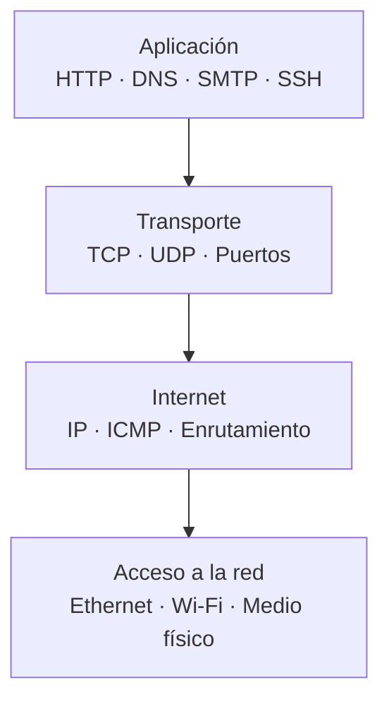

# 🌐 Modelo TCP/IP

> **Objetivo:** comprender la arquitectura que sirve de base a Internet y a la mayoría de redes actuales.

## 1. ¿Qué es TCP/IP?

**TCP/IP (Transmission Control Protocol / Internet Protocol)** es una **suite o conjunto de protocolos** que permite la comunicación entre sistemas conectados en red.

El modelo TCP/IP describe de forma práctica cómo los datos pueden:

* Formatearse.
* Direccionarse.
* Transmitirse.
* Encaminarse.
* Recibirse en el destino.

A diferencia del modelo OSI, que es principalmente un modelo de referencia conceptual, TCP/IP está directamente relacionado con la arquitectura de protocolos utilizada en Internet.

## 2. Las cuatro capas del modelo TCP/IP

El modelo clásico TCP/IP se representa normalmente mediante **cuatro capas**:

1. **Aplicación**
2. **Transporte**
3. **Internet**
4. **Acceso a la red**

## 3. Capa de aplicación

Agrupa muchas funciones que en el modelo OSI se separan entre:

* Capa de aplicación.
* Capa de presentación.
* Capa de sesión.

Aquí encontramos los protocolos que proporcionan servicios a las aplicaciones.

**Ejemplos:**

* HTTP y HTTPS.
* DNS.
* DHCP.
* SMTP.
* FTP.
* SSH.

## 4. Capa de transporte

Proporciona comunicación entre procesos de los extremos y utiliza **puertos** para identificar los servicios.

### TCP

TCP es un protocolo orientado a conexión que proporciona mecanismos de:

* Confirmación.
* Ordenación.
* Retransmisión.
* Control de flujo.
* Control de congestión.

### UDP

UDP es un protocolo sin conexión previa y con menor sobrecarga. No garantiza por sí mismo:

* La entrega.
* El orden.
* La retransmisión.

Por este motivo puede utilizarse cuando la baja latencia es más importante que recuperar cada unidad de información.

## 5. Capa de Internet

Equivale principalmente a la **capa de red del modelo OSI**.

Su función es permitir que los paquetes puedan viajar entre redes diferentes mediante:

* Direccionamiento IP.
* Selección de rutas.
* Encaminamiento a través de routers.

**Protocolos habituales:**

* IPv4.
* IPv6.
* ICMP.

### Ejemplo

Un ordenador puede enviar un paquete a un servidor situado en otra red. El sistema no necesita conocer todos los enlaces intermedios: envía el tráfico hacia la ruta adecuada y los routers se encargan de encaminarlo hasta el destino.

## 6. Capa de acceso a la red

Se ocupa de las funciones relacionadas con el acceso al medio y el enlace local.

En una comparación didáctica con OSI, reúne principalmente funciones de:

* **Capa 2: Enlace de datos**
* **Capa 1: Física**

Incluye tecnologías como:

* Ethernet.
* Wi-Fi.
* Cableado y medios físicos.
* Tramas y direcciones MAC, según la tecnología utilizada.

## 7. Relación entre OSI y TCP/IP

| Modelo OSI       | Modelo TCP/IP   |
| ---------------- | --------------- |
| Aplicación (7)   | Aplicación      |
| Presentación (6) | Aplicación      |
| Sesión (5)       | Aplicación      |
| Transporte (4)   | Transporte      |
| Red (3)          | Internet        |
| Enlace (2)       | Acceso a la red |
| Física (1)       | Acceso a la red |

## 8. OSI vs TCP/IP

| Característica          | OSI                      | TCP/IP                      |
| ----------------------- | ------------------------ | --------------------------- |
| Enfoque principal       | Modelo de referencia     | Arquitectura de protocolos  |
| Número clásico de capas | 7                        | 4                           |
| Uso práctico actual     | Referencia y aprendizaje | Base de Internet y redes IP |
| Organización            | Capas más separadas      | Funciones agrupadas         |

> **Importante:** ambos modelos son útiles. OSI ayuda a entender y diagnosticar; TCP/IP describe la arquitectura práctica sobre la que funcionan la mayoría de redes modernas.

## 9. Uso profesional

En un entorno de trabajo, conocer TCP/IP permite:

* Configurar direcciones IP y puertas de enlace.
* Diagnosticar problemas de conectividad.
* Analizar tráfico con herramientas como Wireshark.
* Identificar problemas de DNS, TCP, UDP o routing.
* Comprender qué ocurre cuando un paquete atraviesa varias redes.

### Comprobación rápida

Cuando una conexión falla, una secuencia útil puede ser:

1. ¿Hay conexión física?
2. ¿Existe conectividad en la LAN?
3. ¿La configuración IP es correcta?
4. ¿La ruta o gateway funciona?
5. ¿El puerto y protocolo de transporte están disponibles?
6. ¿La aplicación o servicio responde?
